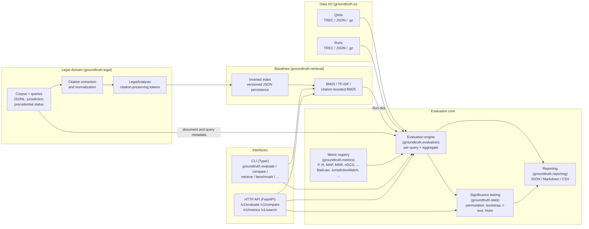
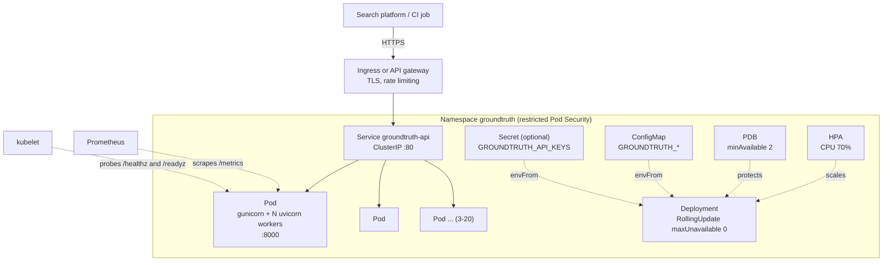

# Architecture

Ground Truth is one Python package (`groundtruth`, distributed as
`groundtruth-legal`) with three entry points over the same core: the library
API, the `groundtruth` CLI and a stateless FastAPI service. Every interface
calls the same evaluation engine, so a score is identical whether it was
computed in a notebook, a CI job or over HTTP.

The authoritative behavior of each component is specified in
`openspec/specs/` (and, until archived, the deltas in `openspec/changes/`).

## Component overview

### Data I/O

`groundtruth.io` parses and writes relevance judgments (qrels) and system runs
in the TREC text format and JSON, transparently handling `.gz` files. Parsing
is streaming and reports the file and line number of malformed input. Qrels and
runs are plain nested dicts (`{query_id: {doc_id: grade_or_score}}`), the same
shape pytrec_eval uses, so data passes between tools without conversion.

Relevance grades follow the legal scale: 0 not relevant, 1 tangential,
2 relevant, 3 controlling / key authority.

### Metrics registry

Every metric implements `groundtruth.metrics.base.Metric` and registers itself
with `@register_metric`. Names such as `nDCG@10`, `P@5` or `BadLaw@10` are
resolved by the registry (base name plus optional cutoff). Metrics receive a
`MetricContext` holding the query's judgments, the ranking produced by
`groundtruth.ranking.rank_documents` (trec_eval tie-breaking), and optional
document and query metadata. Legal metrics register into the same registry, so
the engine, CLI and API do not distinguish between generic and legal metrics.

### Evaluation engine, statistics and reporting

`groundtruth.evaluation.evaluate` scores a run per query and aggregates with an
explicit missing-query policy (`zero`, as `trec_eval -c`, or `skip`) and returns
a JSON-serializable `EvaluationResult`. `groundtruth.stats` compares systems on
paired per-query scores (randomization test, paired bootstrap, paired t-test),
computes bootstrap confidence intervals and applies Holm-Bonferroni correction
across many systems. `groundtruth.reporting` renders results as JSON, Markdown
or CSV.

### Legal corpus, citations and retrievers

`groundtruth.legal` models documents (jurisdiction, court, decision date,
precedential status, citations) and research queries (jurisdiction, binding
jurisdictions, expected citations) and converts them into the metadata legal
metrics consume. Citation extraction normalizes US reporters, U.S.C., C.F.R.
and UK neutral citations into canonical forms; the analyzer turns them into
single tokens so `42 U.S.C. § 1983` matches across spelling variants.

`groundtruth.retrieval` provides deterministic baseline retrievers (BM25,
TF-IDF, citation-boosted BM25) over an in-memory inverted index with
jurisdiction filtering. Indexes persist as versioned, gzip-compressed JSON
(never pickle). Retrievers emit `Run` dicts, so baselines and external
systems are evaluated the same way.

### CLI and HTTP layers

- **CLI** (`groundtruth.cli`, Typer): file-oriented workflows for researchers
  and CI. Domain errors exit with code 2 and a one-line message; failed
  `--fail-under` quality gates exit with code 1.
- **HTTP API** (`groundtruth.api`, FastAPI app factory
  `groundtruth.api.app:create_app`): stateless JSON endpoints. Handlers are
  synchronous so CPU-bound evaluation runs in the threadpool. Pure ASGI
  middleware adds request ids, enforces body-size limits and records Prometheus
  metrics; optional `X-API-Key` authentication protects `/v1`. Settings come
  from `GROUNDTRUTH_*` environment variables (`groundtruth.config.Settings`).
  An optional corpus is loaded and indexed once per worker at startup and
  shared read-only by requests.

## Deployment topology

- Each pod runs gunicorn as the process manager with `WEB_CONCURRENCY`
  uvicorn workers. The API keeps no state between requests, so any pod can
  serve any request and the deployment scales horizontally.
- The image is built from `uv.lock`, runs as uid 10001 on a read-only root
  filesystem with all capabilities dropped and only `/tmp` writable.
- CI builds and smoke-tests the image on every pull request; `main` publishes
  `ghcr.io/imranmali/legal-research-retrieval-evaluation-system:main` and
  `sha-<short>`; `vX.Y.Z` tags publish `X.Y.Z`, `X.Y` and `latest`.

See [deployment.md](deployment.md) for configuration and sizing, and
[`deploy/README.md`](../deploy/README.md) for applying the manifests.
